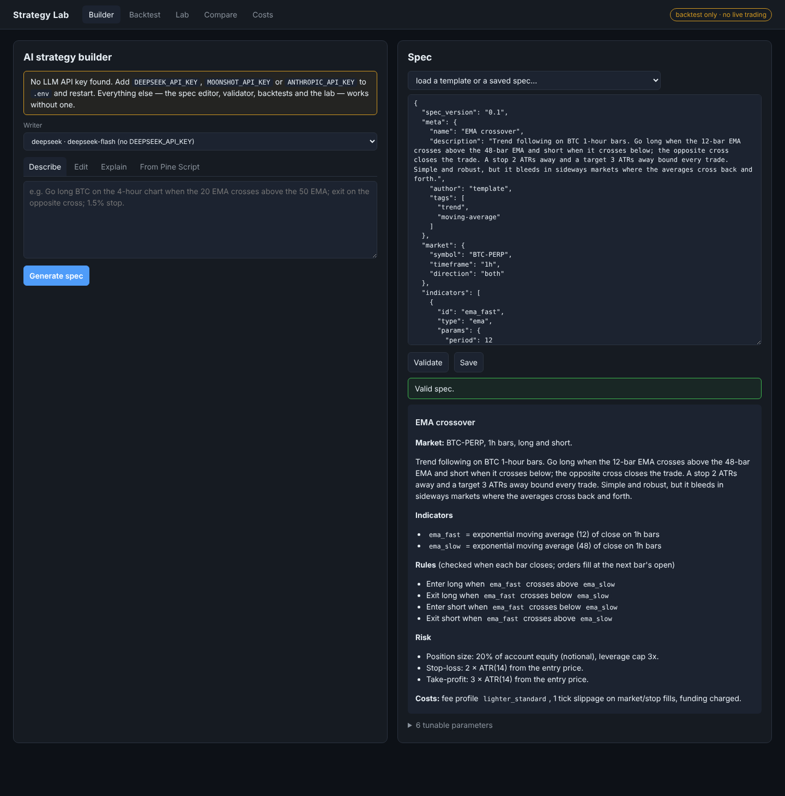
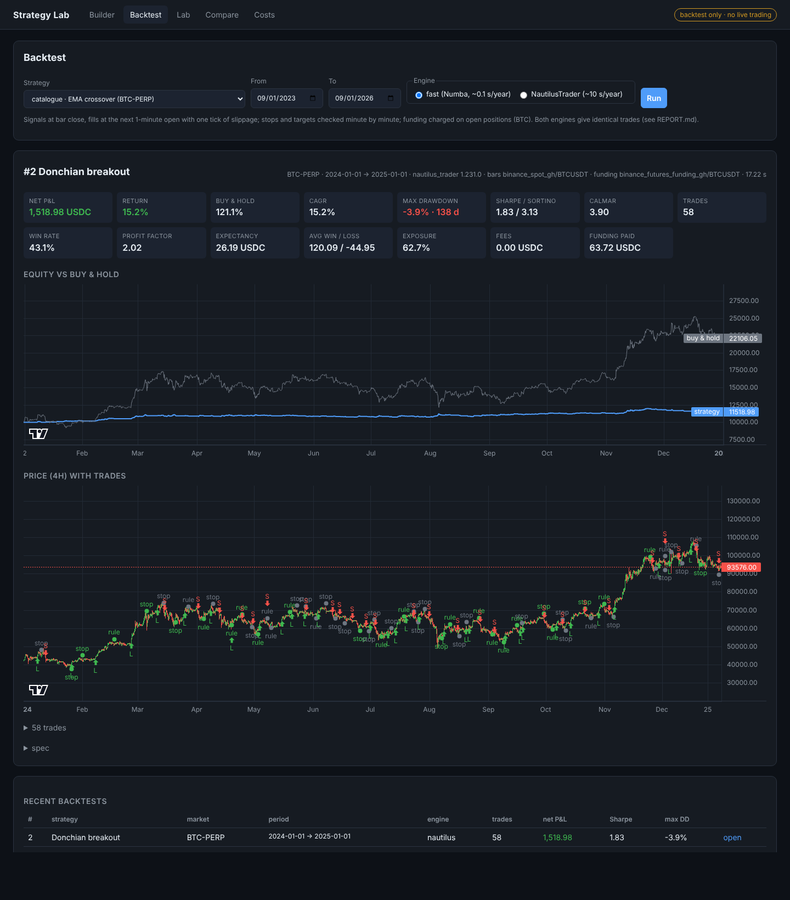
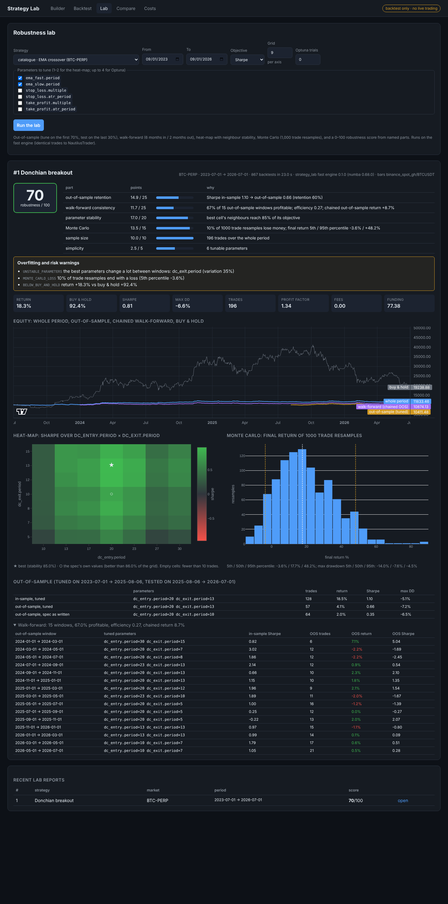
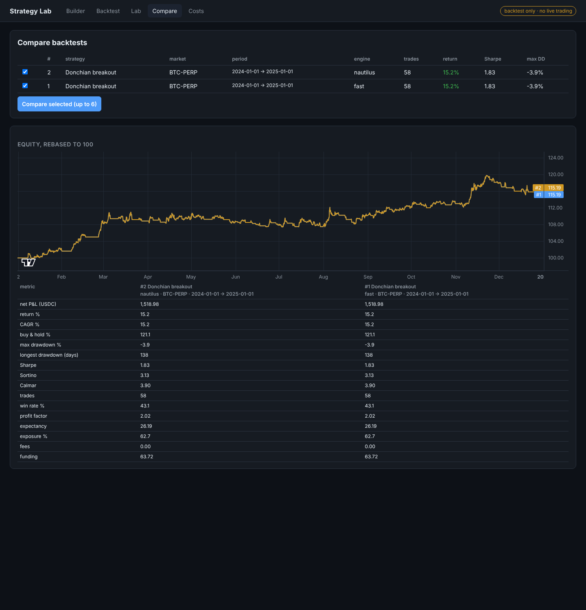
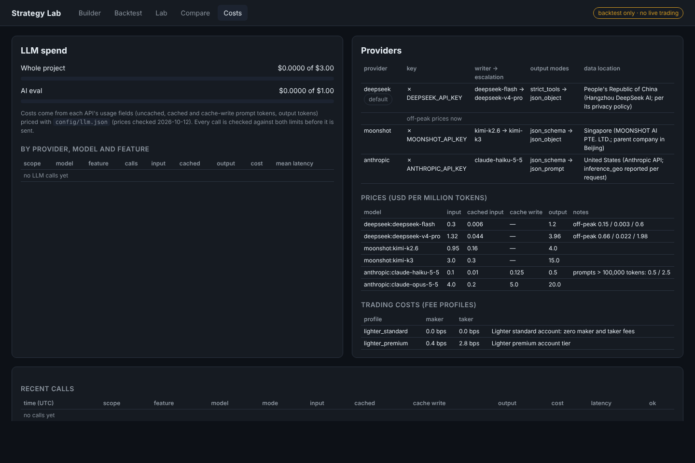

# Strategy Lab Prototype

An evaluation prototype for **Mirrorlane** (a trading terminal for the Lighter perpetuals exchange): describe a
trading idea in plain English (or paste Pine Script), get a validated strategy spec, backtest it on real BTC and
gold history with **NautilusTrader** or a **Numba engine that reproduces it trade for trade**, and stress-test it
in a robustness lab (out-of-sample, walk-forward, heat-map, Monte Carlo, a 0–100 score).

**Backtest only.** Nothing in this project can place an order, hold exchange keys or connect to an account.
The only secrets are optional LLM API keys.

| document | what is in it |
|---|---|
| [REPORT.md](REPORT.md) | measured results and the verdict on NautilusTrader for Mirrorlane |
| [LEARNINGS.md](LEARNINGS.md) | how NautilusTrader really behaves (read from its source, confirmed by code) and other lessons |
| [ARCHITECTURE.md](ARCHITECTURE.md) | packages, execution semantics shared by both engines, AI / lab / API design |
| [DATA.md](DATA.md) | sources, fallbacks, time zones, validation and known gaps of the history |
| [PROGRESS.md](PROGRESS.md) | phase log and definition-of-done checklist |
| [docs/MIRRORLANE_HANDOFF.md](docs/MIRRORLANE_HANDOFF.md) | everything built and learned, every bug with its root cause, and the plan for implementing it in Mirrorlane |
| [docs/MIRRORLANE_LIKE_HYPERDASH.md](docs/MIRRORLANE_LIKE_HYPERDASH.md) | Hyperdash's features mapped onto Lighter: analytics indexer, copy trading, terminal, fees, build order |

## Setup

Needs Linux or macOS, Python 3.13, [uv](https://docs.astral.sh/uv/) and `make`.

1. `git clone <repo> && cd nautilus-test`
2. `make setup` — installs the pinned dependencies from `uv.lock`, the git hooks, a local copy of the chart
   libraries, and creates `.env` from `.env.example`.
3. Optional: put one or more LLM keys in `.env` — `DEEPSEEK_API_KEY` (default writer), `MOONSHOT_API_KEY`,
   `ANTHROPIC_API_KEY`. Without a key everything except the AI builder works.
4. `make data` — downloads, validates and resamples the BTC and XAU history (writes `data/quality_report.md`).
5. `make demo` — the whole pipeline end to end in about a minute.
6. `make ui` — open http://127.0.0.1:8000.

## Make commands

| command | what it does |
|---|---|
| `make help` | list the commands |
| `make setup` | install pinned dependencies (`uv sync --frozen`), pre-commit hooks, vendored UI libraries, `.env` template |
| `make network` | check HTTPS reachability of every data, LLM and CDN host |
| `make data` | download → validate → store (Parquet) → resample BTC and XAU 1-minute history and funding |
| `make lint` | `ruff check`, `ruff format --check`, `mypy` (strict on spec, engines, lab and AI) |
| `make test` | the test suite in parallel (real-data tests skip without `make data`) |
| `make demo` | catalogue validation, one backtest on both engines, a lab run, the AI builder if a key is set |
| `make ui` | the web UI and JSON API on port 8000 |
| `make parity` | fast engine vs NautilusTrader on the 10 catalogue strategies over 2024 → REPORT.md |
| `make bench` | speed and memory of both engines: 1 backtest, 144- and 1,600-run sweeps, 1 and all cores → REPORT.md (hours) |
| `make eval` | the AI builder eval (40 prompts + 5 adversarial) on every provider with a key, spend-capped at $1 → REPORT.md |

Command-line tools behind them: `python -m strategy_lab.ai generate "…"` (also `edit`, `explain`, `from_pine`,
`spend`), `python -m strategy_lab.lab <spec.json> --start … --end …`, `python -m strategy_lab.spec` (exports
`schema.json`), `python -m strategy_lab.engines.nautilus.handwritten`.

## The UI

**Builder** — plain English, an edit request or Pine Script in; a validated spec, its plain-language rendering,
assumptions and every model call with its cost out. The spec editor validates with all errors at once.



**Backtest** — either engine, as a background job; metrics, equity vs buy & hold, candles with trade markers,
the trade list.



**Lab** — robustness score with its named parts, overfitting warnings, equity curves (whole period,
out-of-sample, chained walk-forward), parameter heat-map, Monte Carlo histogram, walk-forward windows.



**Compare** — backtests side by side (here the same run on both engines: identical).



**Costs** — LLM spend against the $3 / $1 limits, per provider, model and feature; providers, prices, data
location; trading fee profiles.



## Layout

```
strategy_lab/   data/ spec/ engines/{nautilus,fast}/ lab/ ai/ api/ ui/
config/         fee_profiles.json, llm.json (models, prices with the date checked, budgets)
evals/          AI eval set, Pine sources, recorded replies, results
benchmarks/     bench.py, parity_report.py, results/
scripts/        check_network.py, vendor_assets.py, demo.py
tests/          unit, integration, parity, API and AI tests
```
